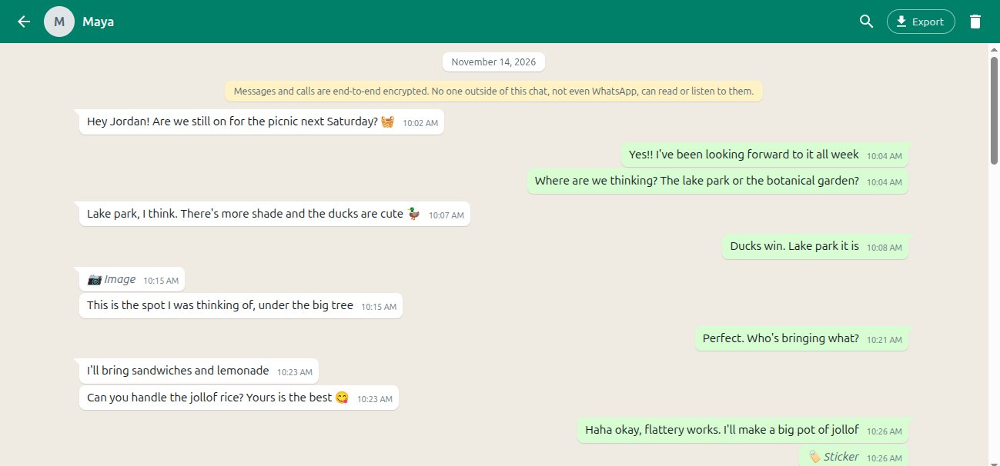

# WhatsApp Chat Viewer

Turn an exported WhatsApp chat (`.txt` or `.zip`) into a clean, searchable chat that looks like a normal WhatsApp conversation, then print it or download it as a document.

**Live demo:** https://whatsapp-chat-viewer-6h1i.onrender.com/

> The demo runs on a free hosting plan. If nobody has used it for a while, the first visit can take up to a minute while the server wakes up.

<!-- Add screenshots here, for example:  -->

## Features

- **Upload a WhatsApp export** as a `.txt` file or a `.zip` (the app finds the chat file inside the zip).
- **WhatsApp-style layout:** green bubbles on the right for you, white bubbles on the left for the other person, timestamps, bubble tails, and a chat-style background.
- **Pinned date headers:** the current day's date stays at the top while you scroll, until the next day replaces it.
- **Search:** find words across the whole chat, with prefix matching (`thank` finds "thanks"), highlighted matches, a "3 of 12" counter, and up/down buttons to jump between results.
- **Export:** open a print-ready document view, choose a date range, then use **Print / Save as PDF** or **Download HTML** (a single offline file with the styling built in).
- **Understands many export formats** (see below), including Android and iPhone exports, 12-hour and 24-hour clocks, and day-first or month-first dates.
- **Handles special messages:** multi-line messages, deleted messages, system notices (such as the encryption notice), and media placeholders (image, video, audio, sticker, document).
- **Privacy built in:** chats are deleted automatically after 24 hours, and can be deleted at any time with the bin button.

## Supported export formats

| Source | Example line |
|---|---|
| iPhone, month first, 12-hour | `[2/2/26, 8:45:05 PM] Name: text` |
| iPhone, day first, 24-hour | `[31/01/2026, 13:53:18] Name: text` |
| Android, 12-hour | `2/2/26, 8:45 PM - Name: text` |
| Android, 24-hour, day first | `02/02/2026, 20:45 - Name: text` |

Date separators can be `/`, `.` or `-`. When a date is ambiguous (for example `01/02/2026`), the app works out whether the chat is day-first or month-first by looking at the whole conversation.

To export a chat in WhatsApp: open the chat, tap the menu, choose **Export chat**, then **Without media**.

## Tech stack

- **Backend:** Python 3.12, [FastAPI](https://fastapi.tiangolo.com/), Uvicorn
- **Database and search:** SQLite with FTS5 full-text search
- **Frontend:** Jinja2 templates, plain HTML, CSS and JavaScript (no build step)
- **Tests:** pytest
- **Hosting:** [Render](https://render.com/)

## Run it locally

You need Python 3.10 or newer.

```bash
git clone https://github.com/bwokomah/whatsapp-chat-viewer.git
cd whatsapp-chat-viewer

python -m venv venv
source venv/bin/activate        # on Windows: venv\Scripts\activate

pip install -r requirements-dev.txt
uvicorn app.main:app --reload
```

Open http://127.0.0.1:8000, upload an export, choose which person you are, and start reading.

### Run the tests

```bash
python -m pytest -q
```

The tests cover the parser (all the formats above), the upload and search API, the chat and export pages, and automatic deletion.

### Configuration

| Environment variable | Default | Meaning |
|---|---|---|
| `DB_PATH` | `chats.db` | Where the SQLite database file is stored |
| `RETENTION_HOURS` | `24` | How long uploaded chats are kept before being deleted |

Uploads are limited to 25 MB.

## How it works

1. **Upload:** `POST /upload` reads the `.txt` or `.zip`, and the parser turns the text into messages (date, sender, text, type).
2. **Store:** messages are saved in SQLite, and text messages are also added to an FTS5 search index. Each chat gets a random link ID.
3. **View:** `GET /c/{id}` renders the conversation. The server groups messages by day, which is what lets the date headers pin and replace each other as you scroll.
4. **Search:** the page calls `GET /chat/{id}/search?q=...`, then highlights matches and scrolls to them.
5. **Export:** `GET /c/{id}/document` shows a print-friendly page, and `GET /c/{id}/download` returns it as a standalone HTML file.

### Routes

| Method | Path | Purpose |
|---|---|---|
| GET | `/` | Upload page |
| POST | `/upload` | Upload and parse a `.txt` or `.zip` export |
| GET | `/c/{id}?me=Name` | Chat page (asks who you are if `me` is missing) |
| GET | `/c/{id}/document` | Print-ready document view, with optional `start` and `end` dates |
| GET | `/c/{id}/download` | Download the document as a standalone HTML file |
| GET | `/chat/{id}` | Chat data as JSON |
| GET | `/chat/{id}/search?q=...` | Search results as JSON |
| DELETE | `/chat/{id}` | Delete a chat |

## Project structure

```
whatsapp-chat-viewer/
├── app/
│   ├── main.py          # FastAPI app and routes
│   ├── parser.py        # WhatsApp export parser (formats, dates, zip handling)
│   ├── db.py            # SQLite storage, FTS5 search, auto-delete
│   ├── templates/       # index, chat, export pages and SVG icons
│   └── static/          # style.css, chat.js
├── tests/               # pytest suite
├── requirements.txt     # runtime dependencies
├── requirements-dev.txt # runtime + test dependencies
└── .python-version      # Python version used on Render
```

## Deploying to Render

1. Push the project to GitHub.
2. On Render, create a **Web Service** from the repository.
3. Use these settings:
   - **Build command:** `pip install -r requirements.txt`
   - **Start command:** `uvicorn app.main:app --host 0.0.0.0 --port $PORT`
   - **Python version:** set by the `.python-version` file
4. Deploy. Every push to `main` redeploys automatically.

## Privacy

WhatsApp chats are personal, so this project is careful with them:

- Each chat is stored under a random ID and is deleted automatically after 24 hours.
- Anyone can delete their chat immediately with the bin button.
- There are no accounts and no analytics.
- Chats are not encrypted in the database, and anyone who has the link to a chat can open it while it exists. For sensitive conversations, run the app on your own computer instead of using the public demo.

Please don't upload chats containing other people's private information to the public demo.

## Known limitations

- **Media files are not shown yet.** Images, videos and audio appear as labelled placeholders, such as "Image" or "Audio".
- **Designed for one-to-one chats.** Group chats load, but sender names are not shown on each bubble yet.
- **Free hosting limits:** the demo sleeps after inactivity, and its storage is wiped when it restarts, so uploaded chats can disappear earlier than 24 hours.

## Roadmap

- Show pictures, videos and audio when they are included in the export file
- Show sender names and colours for group chats

## Author

Built by [@bwokomah](https://github.com/bwokomah).
